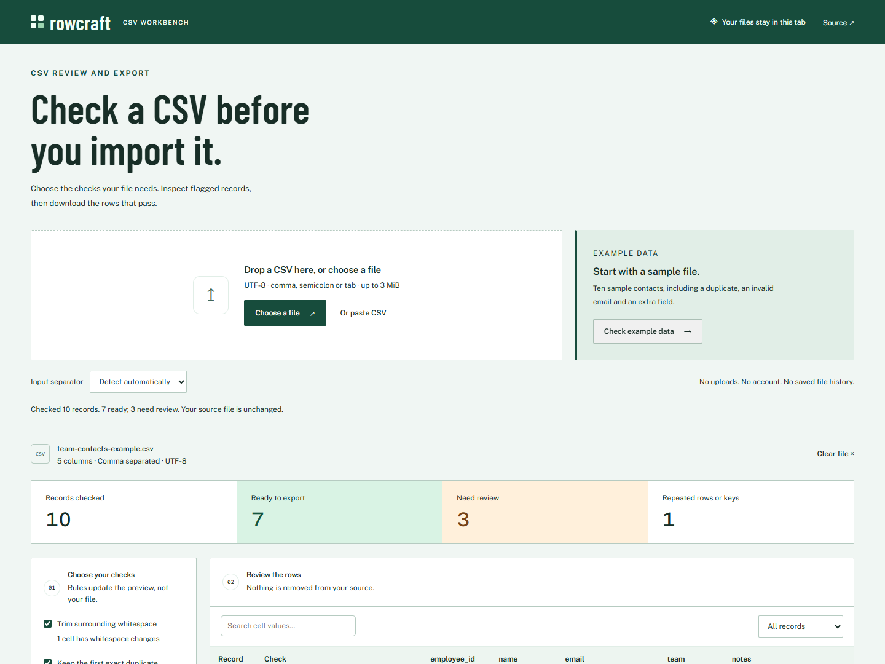

# Ismaeel Habeeb

I build browser tools, backend services and systems utilities. My work spans **Rust, C, TypeScript, JavaScript, Python and SQL**, with an emphasis on data correctness, explicit failure handling and interfaces people can try for themselves.

[Try Rowcraft](https://ismaeelakin.github.io/rowcraft/) · [Review the code](REVIEW_GUIDE.md) · [LinkedIn](https://www.linkedin.com/in/ismaeel-habeeb-01980619b/) · [Contact](mailto:ismaeelakin09@gmail.com)

## Selected projects

| Project | What it does | Where to start |
| --- | --- | --- |
| **[Rowcraft](https://github.com/ismaeelakin/rowcraft)** | Checks CSV files locally in the browser. Review missing fields, duplicates and invalid records before exporting. | **[Use the live app](https://ismaeelakin.github.io/rowcraft/)** — no account or upload required |
| **[Dispatch Ledger](https://github.com/ismaeelakin/dispatch-ledger)** | A TypeScript/SQLite webhook service with tenant isolation, transactional fanout, signed deliveries and retry history. | [Run the local demo](https://github.com/ismaeelakin/dispatch-ledger#readme) · [Source](https://github.com/ismaeelakin/dispatch-ledger/tree/main/src) |
| **[Latency Atlas](https://github.com/ismaeelakin/latency-atlas)** | Rust and C streaming histograms with bounded storage, percentile bounds and overflow checks. | [Design](https://github.com/ismaeelakin/latency-atlas/blob/main/docs/DESIGN.md) · [Independent Python oracle](https://github.com/ismaeelakin/latency-atlas/blob/main/tests/conformance.py) |
| **[RelayBox](https://github.com/ismaeelakin/relaybox)** | A Python/SQLite job queue with token-fenced leases, retry backoff and dead-letter recovery. | [Run it locally](https://github.com/ismaeelakin/relaybox#readme) · [Tests](https://github.com/ismaeelakin/relaybox/tree/main/tests) |

## Try Rowcraft with your own data

Open the example, inspect the flagged records, then download the ready CSV and review report. You can repeat the same workflow with your own file. Processing stays in the browser, including parsing and validation in a Web Worker.

[Live app](https://ismaeelakin.github.io/rowcraft/) · [Architecture](https://github.com/ismaeelakin/rowcraft/blob/main/docs/DESIGN.md) · [Parser and export tests](https://github.com/ismaeelakin/rowcraft/tree/main/test)

## Engineering questions behind the projects

- **What happens when delivery fails?** Dispatch Ledger retains attempt history and separates database transactions from HTTP delivery. RelayBox exercises expired leases, stale workers and replay.
- **How much precision can bounded memory provide?** Latency Atlas returns explicit percentile intervals. Its independent oracle checks the results against exact sorted ranks.
- **What should a data tool preserve?** Rowcraft keeps original values available for inspection and makes excluded rows explicit at export.

The backend projects are runnable reference implementations with documented operating limits. Their repositories include setup instructions, tests and design decisions. **[The review guide](REVIEW_GUIDE.md)** gives a short exercise for each project.

## Languages and tools

**Systems:** Rust, C · **Applications:** TypeScript, JavaScript, Python · **Data:** SQL, SQLite

**Web:** Node.js, Next.js, Django REST Framework · **Workflow:** Git, automated tests, GitHub Actions

## Background and other work

My background is in Industrial and Production Engineering. Alongside programming, I maintain a [publishing platform](https://ismaeel-habeeb-publication.hub-0.workers.dev/) and work on technical documentation. Private application projects include collaboration and job-application workflows.

Earlier JavaScript work remains public: [Guess My Number](https://ismaeelakin.github.io/Guess_My_Number_JS-Project/), [Array exercises](https://ismaeelakin.github.io/js-fundamentals/) and [Loop Trace](https://ismaeelakin.github.io/fundamental_js_part_2/).

For opportunities or a discussion about a project, [email me](mailto:ismaeelakin09@gmail.com).
