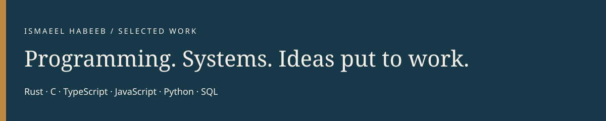
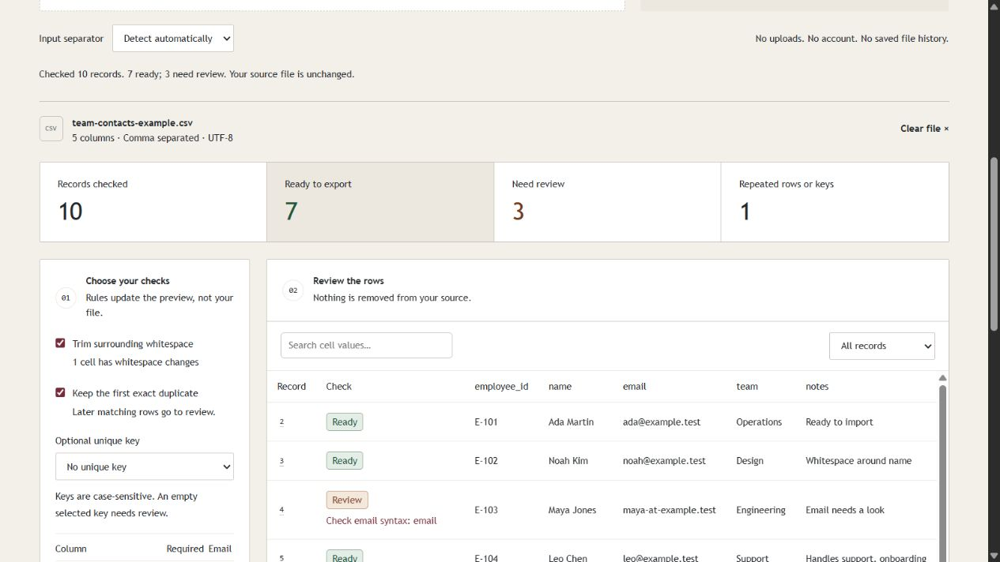

# Ismaeel Habeeb

I build browser tools and backend services with TypeScript, JavaScript, Python and SQL. My current work focuses on file processing, API boundaries and recovery when a request or worker fails.

[Portfolio](https://ismaeel-habeeb-publication.hub-0.workers.dev/) · [LinkedIn](https://www.linkedin.com/in/ismaeel-habeeb-01980619b/) · [Email](mailto:ismaeelakin09@gmail.com)

## Try a product

### [Rowcraft: CSV review and export](https://ismaeelakin.github.io/rowcraft/)

Upload or paste your own file, choose checks, inspect flagged records and export the rows that pass. File contents stay in the browser. No account is required.

[Source](https://github.com/ismaeelakin/rowcraft) · [Design](https://github.com/ismaeelakin/rowcraft/blob/main/docs/DESIGN.md) · [Tests](https://github.com/ismaeelakin/rowcraft/tree/main/test)

## Inspect the engineering

| Project | What to review | How to run it |
| --- | --- | --- |
| [Dispatch Ledger](https://github.com/ismaeelakin/dispatch-ledger) | TypeScript webhook service. Transactional fanout, tenant isolation, HMAC signatures and retained attempt history. | `npm ci` then `npm run demo`; API, worker and local receivers start together. |
| [RelayBox](https://github.com/ismaeelakin/relaybox) | Python/SQLite job queue. Claims, lease fencing, idempotency and dead-letter recovery. | `python -m relaybox.server`; no Python packages required. |
| [Latency Atlas](https://github.com/ismaeelakin/latency-atlas) | Bounded-memory histograms with explicit percentile bounds. Independent Python tests compare Rust and C against exact ranks. | Build the CLIs, then run the documented conformance harness. |

These are reference implementations with documented limits. Their tests and design notes are available alongside the code; production use and independent review are not implied.

## Research and reproducibility

Latency Atlas provides an [independent conformance oracle](https://github.com/ismaeelakin/latency-atlas/blob/main/tests/conformance.py), [numerical design notes](https://github.com/ismaeelakin/latency-atlas/blob/main/docs/DESIGN.md) and a [benchmark procedure](https://github.com/ismaeelakin/latency-atlas/blob/main/docs/BENCHMARKS.md). Dispatch Ledger and RelayBox document failure cases and test transaction and recovery behavior. These are starting points for inspection and replication, not published research claims.

## Other work

I maintain a [publishing and learning platform](https://ismaeel-habeeb-publication.hub-0.workers.dev/) and write technical documentation. Private projects include AkinSpace, a collaboration application, and Jobboard, a job and application workflow. Their source is not public.

My earlier [number game](https://github.com/ismaeelakin/Guess_My_Number_JS-Project) and [JavaScript exercises](https://github.com/ismaeelakin/js-fundamentals) remain as learning work. The pinned repositories are the best place to start a code review.

## Tools

TypeScript · JavaScript · Python · SQL · Node.js · Django REST Framework · Next.js · SQLite · Git

I also study numerical programming through the existing Rust and C implementations in Latency Atlas.

For software development or technical documentation work, [contact me by email](mailto:ismaeelakin09@gmail.com).
